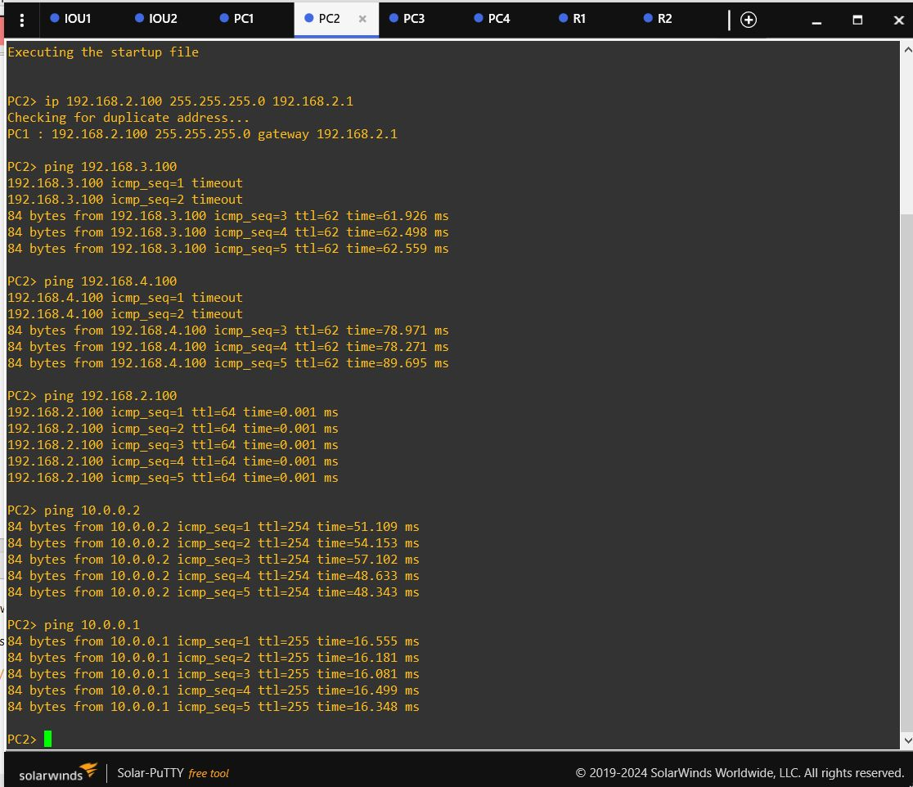

# 03 - OSPF with Inter-VLAN Routing (GNS3)

A two-router GNS3 lab running OSPF (Area 0) between two sites. Each router does inter-VLAN routing with dot1Q sub-interfaces (router-on-a-stick). The README also summarizes how OSPF works and the commands used.

## Files
| File | Description |
|------|-------------|
| `OSPF.gns3` | GNS3 project file (topology) |
| `all-configs.txt` | Configuration of the routers, switches and PCs |
| `ping-test.jpeg` | Ping test from PC2 |

## Topology
- 2 routers: R1, R2 (Cisco c7200, IOS 12.4(25d))
- 2 switches: IOU1, IOU2 (IOU)
- 4 end devices: PC1, PC2 (behind IOU1) and PC3, PC4 (behind IOU2), VPCS

| Link | Connection |
|------|------------|
| R1 f1/0 - R2 f1/0 | 10.0.0.0/30 (R1 10.0.0.1, R2 10.0.0.2) |
| R1 f0/0 - IOU1 e0/2 | Trunk carrying VLAN 10 and 20 |
| R2 f0/0 - IOU2 e0/2 | Trunk carrying VLAN 30 and 40 |
| IOU1 e0/0, e0/1 | PC1, PC2 |
| IOU2 e0/0, e0/1 | PC3, PC4 |

## Addressing
| Router | Interface | VLAN | IP address |
|--------|-----------|------|------------|
| R1 | f0/0.10 | 10 | 192.168.1.1/24 |
| R1 | f0/0.20 | 20 | 192.168.2.1/24 |
| R1 | f1/0 | - | 10.0.0.1/30 |
| R2 | f0/0.30 | 30 | 192.168.3.1/24 |
| R2 | f0/0.40 | 40 | 192.168.4.1/24 |
| R2 | f1/0 | - | 10.0.0.2/30 |

| Device | IP address | Gateway | VLAN |
|--------|------------|---------|------|
| PC1 | 192.168.1.100/24 | 192.168.1.1 | 10 |
| PC2 | 192.168.2.100/24 | 192.168.2.1 | 20 |
| PC3 | 192.168.3.100/24 | 192.168.3.1 | 30 |
| PC4 | 192.168.4.100/24 | 192.168.4.1 | 40 |

## OSPF configuration
R1:
```
router ospf 1
 router-id 1.1.1.1
 log-adjacency-changes
 network 10.0.0.0 0.0.0.3 area 0
 network 192.168.1.0 0.0.0.255 area 0
 network 192.168.2.0 0.0.0.255 area 0
```

R2:
```
router ospf 1
 router-id 2.2.2.2
 log-adjacency-changes
 network 10.0.0.0 0.0.0.3 area 0
 network 192.168.3.0 0.0.0.255 area 0
 network 192.168.4.0 0.0.0.255 area 0
```

Inter-VLAN routing example (R1):
```
interface FastEthernet0/0.10
 encapsulation dot1Q 10
 ip address 192.168.1.1 255.255.255.0
```

The switch sections in `all-configs.txt` (VLANs and trunk ports) were reconstructed from the router and PC settings. They were not exported from the switches.

## Verification
- `show ip ospf neighbor` - neighbor state should be Full
- `show ip route ospf` - routes learned through OSPF
- `show ip ospf interface` - area, cost, timers and DR per interface
- `show ip protocols` - router ID and networks OSPF runs on

Ping test from PC2 to PC3, PC4, 10.0.0.1 and 10.0.0.2 succeeded (the first two packets time out while ARP and routing settle):



## How to open
1. Install GNS3 (2.2.61 or later).
2. Add a Cisco c7200 IOS image and IOU images.
3. Open `OSPF.gns3` from File > Open project.

## How OSPF works
OSPF is a link-state routing protocol. It runs in three phases:

1. **Startup**: routers send Hello packets to the multicast address 224.0.0.5. Two routers become neighbors only if they are directly connected and agree on: Area ID, Hello and Dead timers, authentication, and subnet mask. Router IDs must be unique.
2. **Convergence**: neighbors exchange Database Description (DBD) packets, request missing information with Link State Request (LSR), receive it in Link State Update (LSU), and confirm with LSAck. Each router then runs Dijkstra's SPF algorithm on its link-state database to build its routing table.
3. **Change**: when the topology changes, the router floods a triggered LSU and every router recalculates. Unlike RIP, OSPF does not send its whole routing table every 30 seconds.

On shared networks such as Ethernet, routers elect a DR (Designated Router) and a BDR (Backup DR).
## Other useful OSPF commands
| Command | Purpose |
|---------|---------|
| `passive-interface g0/1` | Advertise the network without sending Hellos |
| `default-information originate` | Advertise a default route |
| `ip ospf cost 10` | Set the cost manually on an interface |
| `ip ospf priority 100` | Influence DR election |
| `ip ospf hello-interval 5` / `ip ospf dead-interval 20` | Change timers (must match on both sides) |
| `ip ospf authentication message-digest` and `ip ospf message-digest-key 1 md5 <key>` | MD5 authentication between neighbors |
